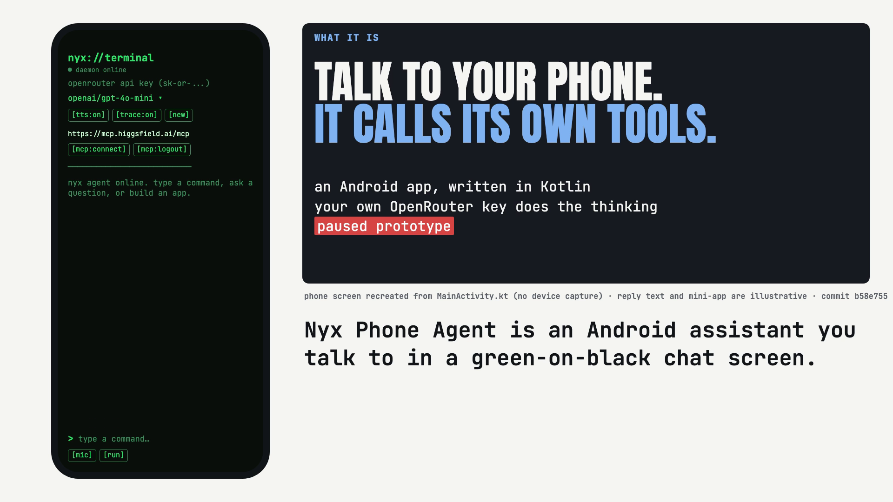

# Nyx Phone Agent

**An Android assistant you talk to in a chat screen: you type or speak a request, a cloud model (through your own OpenRouter key) picks phone tools, and Nyx opens apps, changes settings or builds a small app for you. It is a paused, unfinished prototype.**

[](https://nojuannobody.github.io/nyx-phone-agent/explainer/explainer.mp4)

[▶ Watch the 60-second explainer](https://nojuannobody.github.io/nyx-phone-agent/explainer/explainer.mp4) · [Read the one-page explainer](https://nojuannobody.github.io/nyx-phone-agent/explainer/)

### How it works for you

1. Install the `agent-launcher` app, paste your OpenRouter API key, and pick a model (default `openai/gpt-4o-mini`).
2. Type a request, or tap `[mic]` and say it: for example "build me a tip calculator".
3. Nyx sends the chat and its list of phone tools to the model; the model chooses a tool such as `build_app`.
4. Nyx runs it — here it saves a self-contained HTML app and opens it full screen — and shows a cyan `[tool]` line for each call.
5. The reply is spoken aloud and offers to add the app to your home screen; say yes and Android asks you to confirm the icon.

**Status:** the owner has closed this project. The chat app path above is the working code; the call receptionist,
sales pipeline and on-device voice engine are written but not part of the Gradle build, and there is no meeting bot.

---

Android agent that observes and acts on a phone on the user's behalf. On-device inference is planned (docs/ROADMAP.md); the current app calls a cloud model through OpenRouter.

## Architecture

Multi-module Gradle project (Kotlin; Android library/app modules plus pure-JVM modules). Modules in the build
(`settings.gradle.kts`):

```
agent-launcher/ Installable app: terminal-style chat UI, voice in/out, MCP login, mini-app host
agent-core/     ACP, Policy Engine, MCP Registry, Intent Bridge, LLM Inference, Skill Router
agent-app/      ConversationalAgent, Planner, NyxAgentDaemon, background loop, orchestration
skills/         UI interaction, app-launch, notifications, voice I/O, SMS, system controls
llm/            OpenRouter chat client and LLM backend
backend/        Tenants, billing meter, onboarding
```

Present in the repo but **not** included in the build: `voice/` (Whisper/Kokoro/wake word), `receptionist/`
(call auto-answer + persona routing), `sales/` (post-call lead scoring), and `aosp/` (system-image config).
CI lives in `.github/workflows/`.

## Building

Requires JDK 17 and the Android SDK.

```bash
./gradlew build
./gradlew test
```

## Issues

All issues are code-only — no markdown documentation files accepted as deliverables.
Spec content is inlined as KDoc comments in source files.
